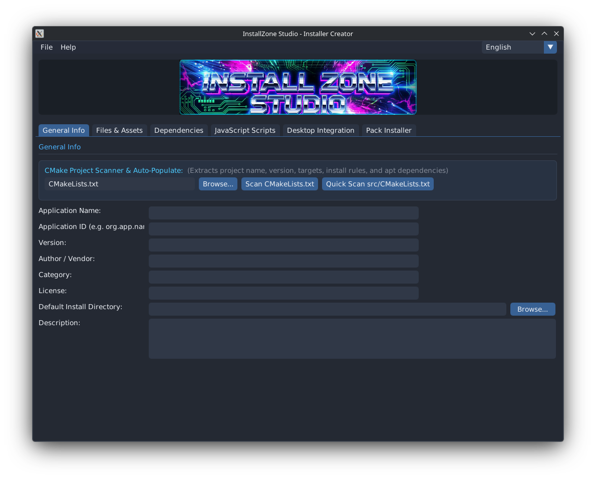
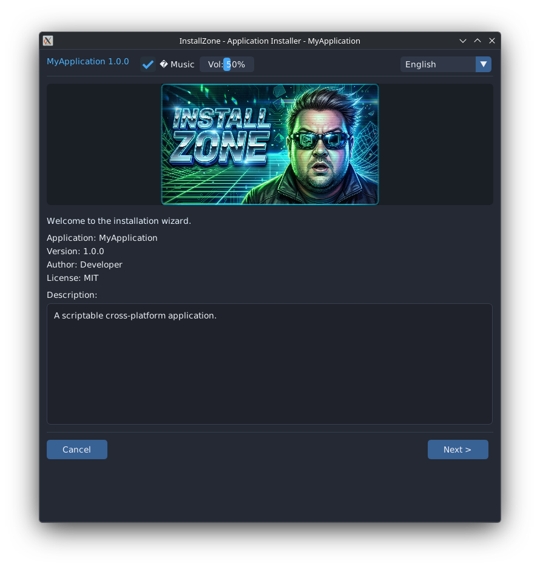

# InstallZone

<div align="center">


### Professional Modular Scriptable Installer System for Linux
*Targeting Kubuntu 26.04.1 LTS with KDE Plasma & Modern Linux Distributions*

[English](docs/README_en.md) | [Українська](docs/README_uk.md) | [日本語](docs/README_ja.md) | [简体中文](docs/README_zh.md)

[Scripting Guide (EN)](docs/SCRIPTING_en.md) | [Довідник скриптів (UK)](docs/SCRIPTING_uk.md) | [スクリプトガイド (JA)](docs/SCRIPTING_ja.md) | [脚本指南 (ZH)](docs/SCRIPTING_zh.md)

</div>

---

## 📸 Screenshots

<div align="center">

### InstallZone Studio (Creator & Packager IDE)
*Intuitive multi-tab IDE with automated CMakeLists.txt scanning, file browsing, dependency configuration, and JavaScript hook scripting.*



<br/>

### InstallZone Runner (Self-Extracting Wizard)
*Early 2000s GPU box-art aesthetic, retro looping chiptune audio, single-prompt sudo elevation, and seamless FreeDesktop XDG menu integration.*



</div>

---

## 📖 Overview

**InstallZone** is a C++17 modular application packaging and installation system tailored for Linux, with special attention to Kubuntu 26.04.1 LTS and the KDE Plasma desktop environment.

It utilizes **OpenGL 2.1** and **Dear ImGui** for maximum graphics hardware compatibility across older and modern GPUs, paired with an embedded **JavaScript** engine (Duktape) for executing advanced setup routines—such as generating user configuration directories (`~/.config/`), configuring tool dependencies like `navi`, and creating XDG FreeDesktop shortcuts.

```
┌─────────────────────────────────────────────────────────────┐
│                    InstallZone Ecosystem                    │
├───────────────────────────────┬─────────────────────────────┤
│   App 1: InstallZone Studio   │   App 2: Base Runner        │
│   (Installer Creator & IDE)   │   (Self-Extracting Wizard)  │
├───────────────────────────────┴─────────────────────────────┤
│            Shared Core (libinstallzone_core)                │
│   ┌──────────────┐ ┌──────────────┐ ┌───────────────────┐   │
│   │ Project JSON │ │  JS Engine   │ │ Archive Container │   │
│   │ Serialization│ │  (Duktape)   │ │ Pack & Extract    │   │
│   └──────────────┘ └──────────────┘ └───────────────────┘   │
│   ┌──────────────┐ ┌──────────────┐ ┌───────────────────┐   │
│   │ Multilingual │ │  JPL Safety  │ │ System & Desktop  │   │
│   │ i18n (12 Ls) │ │  Framework   │ │ Polkit Elevation  │   │
│   └──────────────┘ └──────────────┘ └───────────────────┘   │
├─────────────────────────────────────────────────────────────┤
│         Backend: SDL2 + OpenGL 2.1 + Dear ImGui             │
└─────────────────────────────────────────────────────────────┘
```

---

## ✨ Features

### Application 1: InstallZone Studio (`installzone-studio`)
- **Visual Project Management**: Complete GUI to define applications, file payload hierarchies, permissions, and dependencies.
- **Intelligent CMake Project Scanner**:
  - Automatically parses `CMakeLists.txt` to extract project name, version, description, and targets.
  - Automatically locates compiled binaries (`<project>/<target>`, `<project>/build/<target>`) and computes payload sizes.
  - Automatically detects application icons (`.png`, `.svg` in project root, `icons/`, `desktop/`, `assets/`) and existing `.desktop` configurations.
  - Automatically maps `find_package(...)` dependencies to Debian/Ubuntu APT packages (`libgl-dev`, `libsdl2-dev`, `pkg-config`, etc.).
- **Native File Browsers**: Integrated KDE `kdialog` / `zenity` file and folder picker dialogs for all path inputs.
- **JSON Project Format (`.izproj`)**: Clean, human-readable, and version-controllable project manifests.
- **Embedded JavaScript Sandbox**: Test and edit `pre_install`, `post_install`, `pre_uninstall`, and `post_uninstall` hooks with live log console output.
- **Standalone Packaging Engine**: Merges the base runner executable, project manifest, compressed payload files, application icon, 2000s GPU banner, and looping chiptune audio into a single standalone `.run` binary with CRC32 verification.

### Application 2: InstallZone Runner (`installzone-runner`)
- **Self-Extracting Standalone Wizard**: Distributed with each generated `.run` installer with zero external runner requirements.
- **Early 2000s GPU Box Art Header**: High-energy retro aesthetic with glowing CRT effects and hair-blasted wind-tunnel artwork.
- **Authentic Retro Chiptune Audio**: Built-in looping chiptune soundtrack with volume control (defaults safely to 50%) and mute toggle.
- **Standard Linux Installation Paths**:
  - Binaries install directly to `/usr/bin` (or custom prefix).
  - Desktop entries install to `/usr/share/applications` with proper categories and exec paths.
  - Icons install to `/usr/share/pixmaps` and `/usr/share/icons/hicolor/scalable/apps` with `0644` permissions.
- **Single-Prompt Administrator Elevation**:
  - Automatically detects when system directories (`/usr/bin`, `/opt`) or missing APT dependencies require root permissions.
  - Prompts once graphically via KDE `kdialog --password` or `zenity`, batch-installs dependencies via `apt-get`, and safely extracts payload files.
- **Uninstaller Generation**: Automatically creates uninstaller manifests and `/usr/bin/<app>-uninstall.sh` for clean one-click uninstalls.

### Engineering & Safety Standards
- **JPL (NASA/Jet Propulsion Laboratory) Software Compliance**:
  - Strict bounded loop iterations (`kMaxLoopIterations`) preventing execution lockups.
  - Fixed-size bounded queue models for log streaming and data transfers.
  - Explicit function status returns (`iz::StatusCode`).
  - No recursion; strictly iterative tree and archive extraction.
- **Zero ImGui Context Loss Threading**:
  - UI rendering is strictly isolated to the main thread.
  - File I/O, archive extraction, and JavaScript execution run on separate background worker threads synchronized via a thread-safe `WorkerBridge`.
- **12 Out-of-the-Box Languages**:
  - English (`en`), Ukrainian (`uk`), Japanese (`ja`), Chinese (`zh`), Spanish (`es`), French (`fr`), German (`de`), Portuguese (`pt`), Italian (`it`), Polish (`pl`), Korean (`ko`), and Russian (`ru`).
- **Clean Root Repository**:
  - The root directory only contains `install.sh`, `reinstall.sh`, `uninstall.sh`, `README.md`, `.gitignore`, and Git files.

---

## 🚀 Installation & Usage

### 1. Build and Install

```bash
# Builds both applications and installs binaries to /usr/bin
./install.sh
```

### 2. Launching Studio

Launch **InstallZone Studio** from your KDE Plasma Application Launcher or from your terminal:

```bash
installzone-studio
```

### 3. Reinstall or Uninstall

```bash
# Rebuild and reinstall updated files
./reinstall.sh

# Complete removal
./uninstall.sh
```

---

## 🛠️ Building from Source Manually

```bash
cmake -S src -B build -DCMAKE_BUILD_TYPE=Release
cmake --build build -j$(nproc)
```

The resulting binaries will be in `build/`:
- `build/installzone-studio`
- `build/installzone-runner`

---

## 📄 License

InstallZone is licensed under the MIT License.
